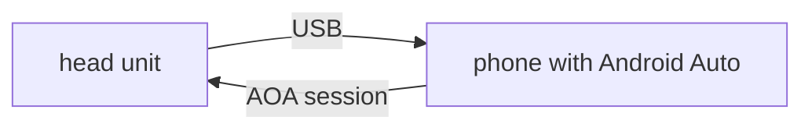

# 07 — Verification

A write that is accepted is not a feature that works. This chapter separates the
four things people conflate.

## The four levels

| Level | Question | How to answer |
|---|---|---|
| 1. Accepted | did the unit take the frame? | the write answer (`6E 6C 1C`) |
| 2. Stored | is the value there afterwards? | read `0x6C1C` again |
| 3. Visible | does the UI show it? | restart, look at the menu |
| 4. Working | does a phone actually project? | connect a phone over USB |

Level 1 alone proves almost nothing: a request can be accepted and ignored. Level 2
is the first real evidence. Level 3 shows the software reacted. Only level 4 shows
the feature works.

## Level 1 and 2 — after the write

The tool does both automatically, in one run:

```
write    : 2E6C1C78 → 6E 6C 1C
readback : 0x78
```

If you used DDT4All or any other tool, verify with the reader:

```bash
./tools/read_config.py --port /tmp/obdlink-mx
```

Expected: `0x78`, with MirrorLink still present. `TESTED`.

If the read-back differs from the target, the tool exits 8 and stops. Do not run
it again in the same session; the unit accepted a frame but did not store the
value, and a second write is a decision, not a retry.

## Level 3 — after a restart

The head unit caches the vehicle configuration. Changing the byte does not
immediately change the menu.

1. Ignition off, wait about 30 seconds, ignition on.
2. Let the head unit finish booting.
3. Open the phone-projection menu (on this unit: *Smartphone Screen*).

Expected, `REPORTED` by the vehicle owner after the 2026-11-08 activation:

- Android Auto settings appear in the Smartphone Screen menu,
- an Android Auto tutorial entry appears alongside the MirrorLink ones,
- the setting for automatic Android Auto start is reachable,
- MirrorLink is still present.

If nothing changed after a restart, work through `troubleshooting.md` before
touching the byte again. Re-reading the value tells you whether the write stuck:
`0x78` with no menu means the software did not pick it up; `0x38` means it was not
stored.

## Level 4 — the actual projection (NOT TESTED)

This project has **not** connected a phone after the activation. Everything below
is untested and is the next thing to verify.



Checks, in order:

1. Connect an Android phone with the Android Auto app installed to the USB port.
2. The unit should offer Android Auto; accept, or set it to start automatically.
3. Confirm the phone screen is mirrored and the unit's touch input works.
4. Confirm audio output and microphone input.
5. Confirm navigation and that the connection survives a reconnect.

Report each of these separately. "Android Auto works" is not a test result;
"projection established, touch and audio confirmed, microphone untested" is.

## What does not count as verification

- A menu entry: it proves the configuration was read, not that the stack runs.
- A positive write answer: it proves the frame was accepted.
- A successful read-back alone: it proves the byte is stored.
- A phone that charges over USB: that is not a projection session.

## Recording results

The reader can write its output to JSON:

```bash
./tools/read_config.py --port /tmp/obdlink-mx --json logs/after.json
```

Keep before and after files. Together with the tool's own JSONL log they form a
complete record: what was read, what was sent, what came back.
